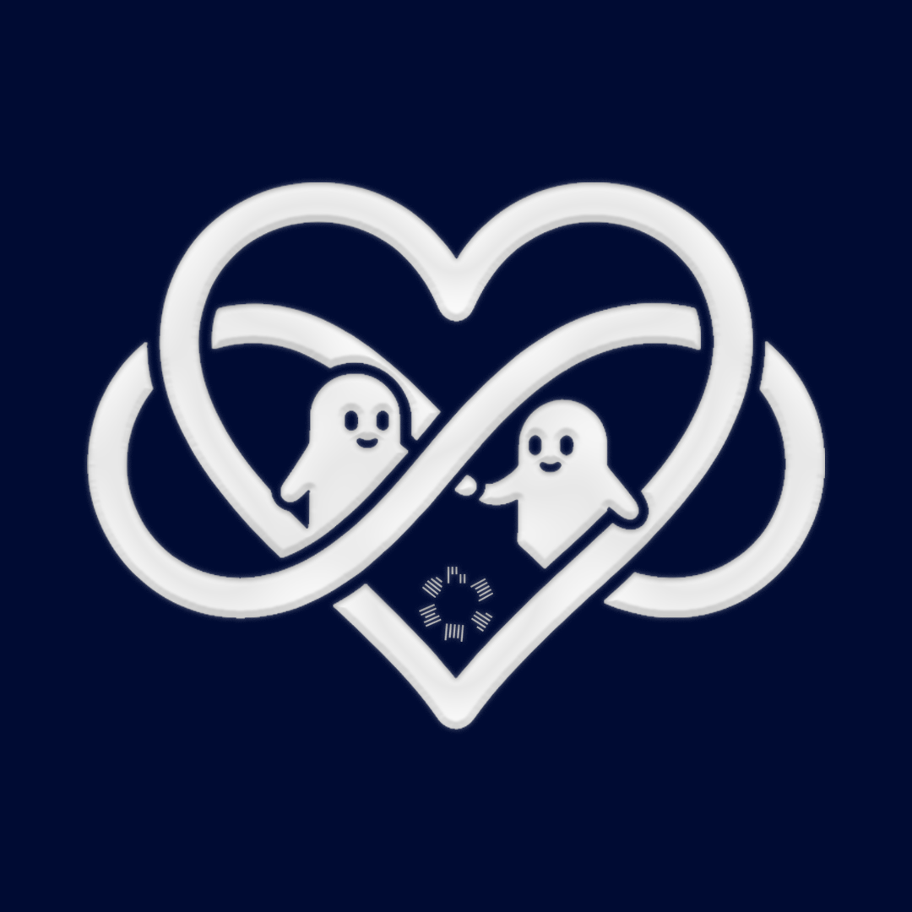
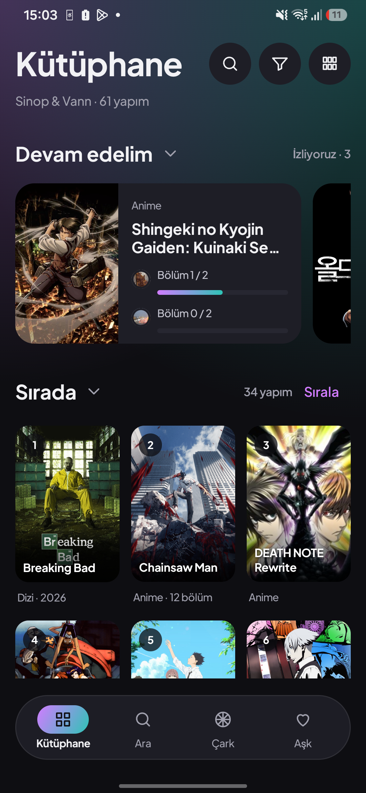
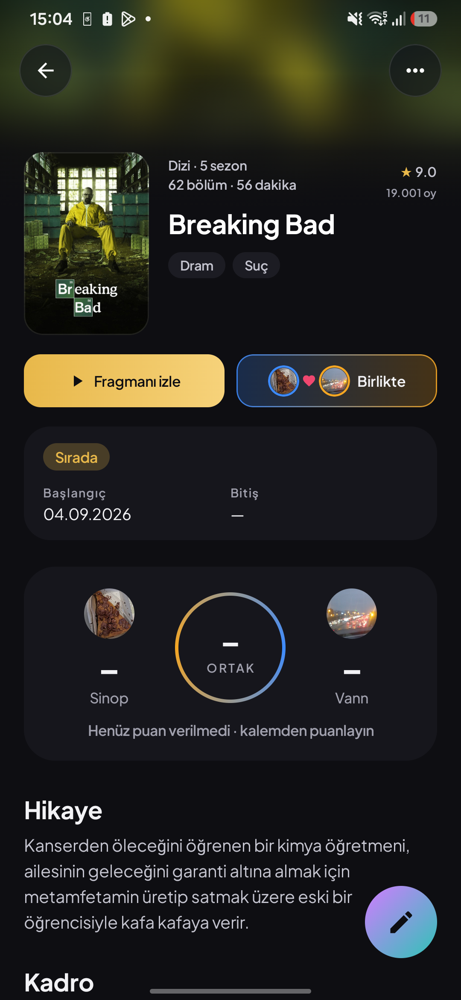
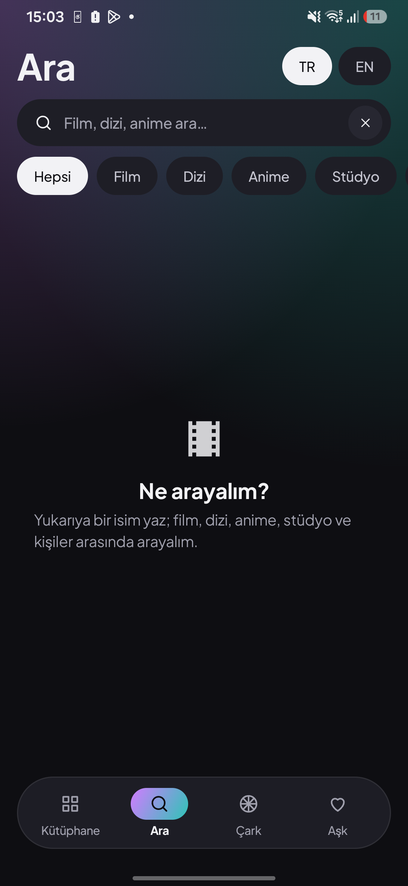
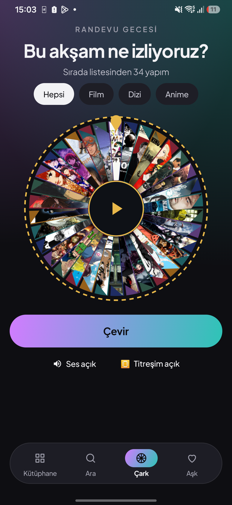
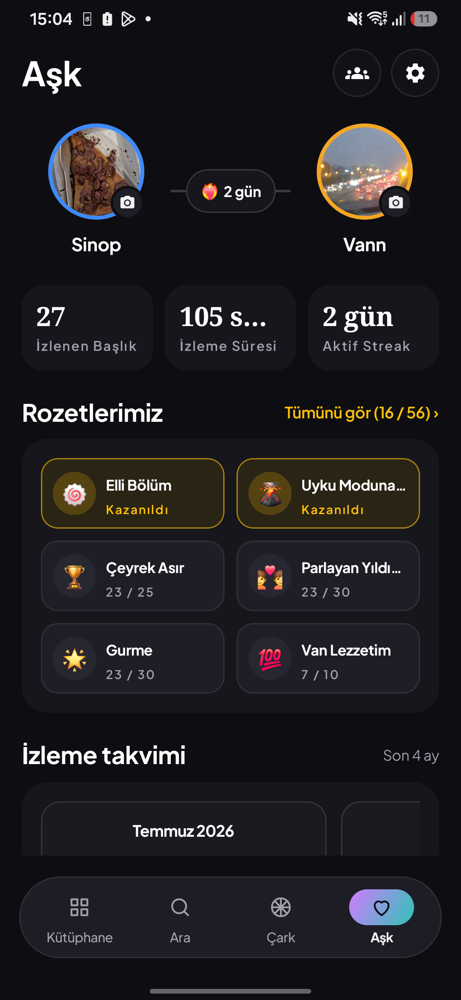
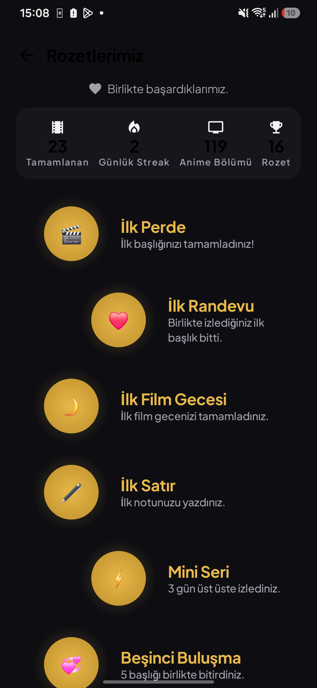

<div align="center">



# 🎬 Minimuv

**"bizim izleme defterimiz"** · Van & Sinop için özel olarak tasarlanmış, **yalnızca iki kişilik** film, dizi ve anime takip uygulaması.

Letterboxd'ın sinefil poster estetiği ile Duolingo'nun oyunlaştırılmış tatlı dilini bir araya getirir: ikimiz ayrı ayrı puan veriyoruz, bölüm notları spoiler kilidiyle korunuyor, ne izleyeceğimize çark karar veriyor ve rozetler ortak başarılarımızı kutluyor.

<p>
  
  
  
  
  
</p>

</div>

---

## 📱 Ekran Görüntüleri

| 📚 Kütüphane | 🎬 Yapım Detayı | 🔍 Akıllı Arama |
| :---: | :---: | :---: |
|  |  |  |

| 🎡 Randevu Çarkı | 💑 Aşk & Profil | 🏅 Rozetler | ⚙️ Ayarlar |
| :---: | :---: | :---: | :---: |
|  |  |  |  |

---

## ✨ Özellikler

### 📚 Kütüphane & Görünüm Modları
* **Gruplandırılmış Katmanlar:** *Devam edelim (İzliyoruz)*, *Sırada*, *Tamamlandı*, *Bıraktık* kategorileri.
* **4 Farklı Görünüm:** Kompakt liste, poster satırları, 3'lü ızgara ve 2'li büyük ızgara seçenekleri.
* **Sürükle-Bırak Sıralama:** "Sırada" listesini basılı tutarak kişisel öncelik sırasına koyma.
* **Arama & Filtreleme:** Kütüphane içinde hızlı kelime araması; durum, format (Film/Dizi/Anime), çıkış yılı ve gelişmiş sıralama kriterleri.

### 🎬 Detay & Kartlı Düzenleme
* **Zengin İçerik Bilgileri:** TMDB ve AniList kaynaklı yüksek çözünürlüklü kapak/backdrop, Türkçe ve İngilizce özetler, oyuncu/karakter kadrosu, yönetmen ve stüdyo bilgileri.
* **Bölüm Takibi & İlerleme:** Tek dokunuşla bölüm artırma/azaltma. İlerleme tamamlandığında düşen **konfeti animasyonu**.
* **Katlanabilir Düzenleme Kartları:** Durum, Bölüm, Takvim, Puanlar ve Notlar için pratik düzenleme kartları.

### 💯 Çift Puanlama Sistematiği
* **Ortak Puan:** Her iki taraf kendi puanını verir; kartlar üzerinde ikinizin puan ortalaması görünür.
* **Detaylı Puanlama:** Hikaye, Karakterler, Görsellik, Ses ve Keyif olmak üzere 5 alt kategoride bağımsız 0–10 arası değerlendirme.

### 🎡 Randevu Gecesi Çarkı
* **Görsel Afişli Çark:** "Sırada" bekleyen yapımları kura çarkına dizer.
* **Ses & Titreşim Desteği:** Dönüş esnasında mekanik tik sesleri (`WheelSound`) ve kazanan belirleme marşı. Kazanan kartı şık bir popup ile kutlanır.

### 🏅 Rozet Yolculuğu & İstatistikler
* **Ortak Başarılar (27+ Rozet):** Çiftin birlikte tamamladığı maratonlar, izleme serileri ve özel kategoriler için açılan rozetler.
* **İzleme Takvimi & Yıl Özeti (Wrapped):** Katkı haritası (Heatmap) ve Spotify tarzı yıllık izleme özeti.

### 🔔 Gerçek Zamanlı Senkronizasyon & Bildirimler
* **Supabase Realtime:** İki cihaz arasında yapılan her değişiklik anında senkronize olur.
* **Üç Katmanlı Bildirim:** Realtime (uygulama açıkken), Edge Function + FCM (uygulama kapalıyken) ve WorkManager periyodik denetleyicisi.

---

## 🛠️ Teknoloji Yığını

| Katman | Kullanılan Teknolojiler |
| :--- | :--- |
| **Dil & Arayüz** | Kotlin 2.3+ · Jetpack Compose (Material 3) · Navigation Compose |
| **Backend & Veritabanı** | Supabase (Postgres, Realtime, Storage) · [supabase-kt 3.5](https://github.com/supabase-community/supabase-kt) |
| **Ağ & Medya** | Ktor 3.4 (OkHttp) · Coil 3 · kotlinx.serialization |
| **API Servisleri** | TMDB API (Film & Dizi) · AniList GraphQL API (Anime) |
| **Bildirim & Dağıtım** | Firebase Cloud Messaging (FCM) · Firebase App Distribution · WorkManager |
| **Tasarım Sistematiği** | Midnight Dark Theme · Plus Jakarta Sans Font · Edge-to-Edge |

---

## 🚀 Derleme & Geliştirme

### Gereksinimler
* Android Studio (JDK 17+, AGP 9.x)
* `minSdk 26` (Android 8.0) · `targetSdk 36`

### 1) TMDB API Anahtarı
Projenin kök dizinindeki `local.properties` dosyasına API anahtarınızı ekleyin:
```properties
tmdb.api.key=BURAYA_TMDB_API_KEY_GELECEK
```

### 2) Derleme Komutları

```bash
# Debug APK derlemesi
./gradlew :app:assembleDebug

# GitHub Release (API'siz APK):
./gradlew :app:assembleRelease -PtmdbApiKey=""

# Firebase / Kullanıcı Release (API'li APK):
./gradlew :app:assembleRelease
```

---

## 📄 Lisans

Van & Sinop için sevgiyle yapılmış özel çift takip uygulaması. Her hakkı saklıdır. 💑
